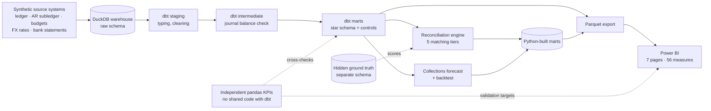
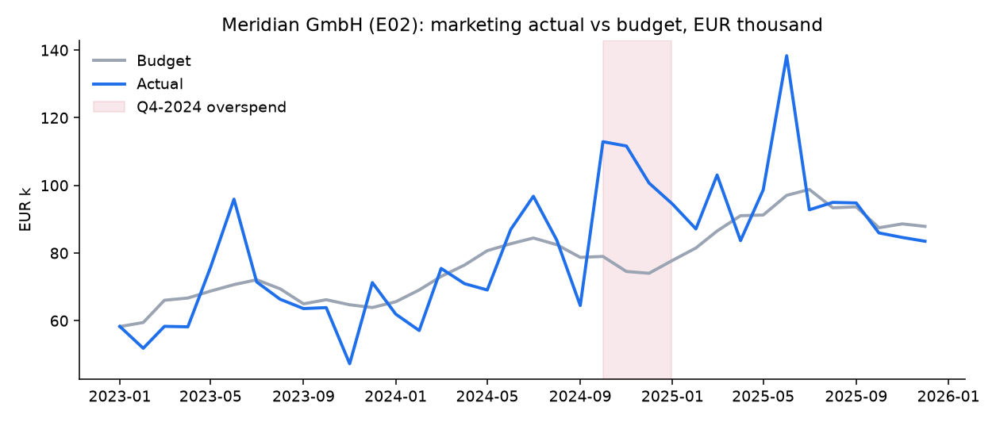
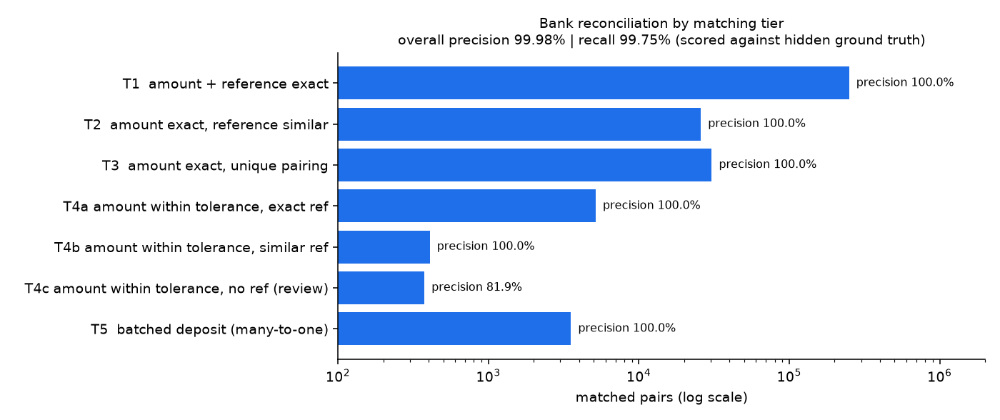
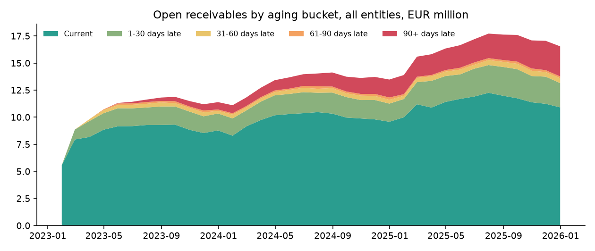
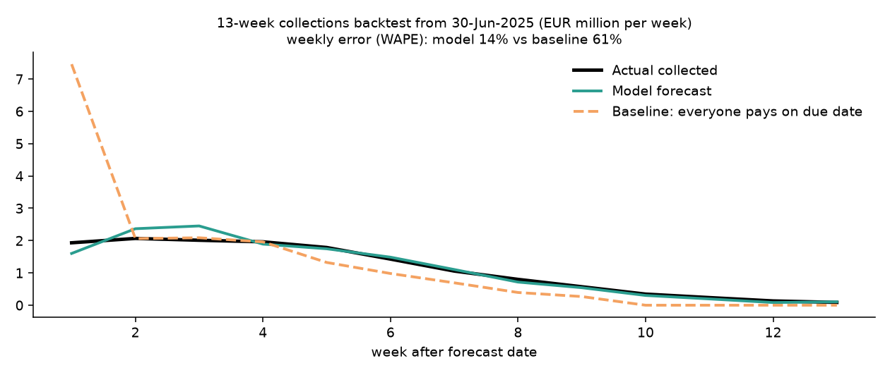

# Finance Analytics Platform

**Budget-variance analysis, bank reconciliation, receivables aging and cash forecasting for a multi-entity company, built with dbt, DuckDB, Python and Power BI.**

A finance team closes the books by answering four questions: *Where did we miss budget, and why? Do the bank statements
match the ledger? Who owes us money and how late? How much cash will arrive?* This project answers each one with tested
code, and it measures its own accuracy against a hidden ground truth instead of just asserting that it works.

> **Everything here is synthetic.** The company ("Meridian"), customers and numbers are invented, and nothing is derived
> from any real employer's data or schema. Problems were *planted* in the data on purpose (a marketing overspend, a
> supplier price rise, a lost customer, unbalanced journals, messy bank references...), so the platform's findings can be
> checked against a known answer. The value on show is the **method and its verification**, not business discoveries.

## At a glance

| | |
|---|---|
| **Scale** | 5 legal entities, 3 currencies (EUR/USD/TND), 36 months: **1.49 M ledger lines** (652 k journals), 120 k invoices, 317 k bank lines |
| **Warehouse** | DuckDB, built by **dbt: 24 models, 65 tests** (12 are custom accounting controls) |
| **Bank reconciliation** | **99.03 %** of bank lines matched; scored against ground truth: **precision 99.98 %, recall 99.75 %** |
| **Budget-variance alerts** | all 4 planted budget shocks detected (one only narrowly), **1 false alarm** |
| **Cash forecast (13 weeks)** | weekly error **14.4 %** vs **61.7 %** for the naive baseline; volume bias +1.3 % vs +19.9 % |
| **Tests** | 89 dbt checks + **36 pytest** tests, including **5 mutation tests** that corrupt the data and assert the controls fire |
| | **Power BI** | 7-page report (see `docs/figures/powerbi/`), **56 DAX measures** checked against 32 KPI targets, RLS design; report template in `docs/powerbi/` | | 7-page spec, **56 DAX measures**, RLS design, 32 KPI targets to validate against. Power BI report and DAX | **Built in Power BI Desktop; all 32 KPI targets matched.** The `.pbix` is not committed (size); a `.pbit` template and a PDF are in `docs/powerbi/`|
| **Rebuild** | one command, about a minute |

## Architecture



The reconciliation engine and the ground truth live in **separate schemas**: the engine never sees the answer key, and
`recon/evaluate.py` scores it afterwards.

## What it finds

### 1. Budget vs actual, split into "operational" and "currency"

Every P&L line is compared with budget in EUR, and the variance is split into two parts that **sum exactly** (asserted by a dbt test):
*operational* = (actual − budget) × budget rate, *FX* = actual × (actual rate − budget rate).
FY2025: revenue **€91.1 M**, operating income **€16.4 M (18.0 %)**, **€1.62 M below budget**, made of **−€1.71 M operational** and **+€0.09 M currency**.

A sorted variance list is misleading (large, noisy revenue lines always rank first), so the platform scores **sustained** variances with a robust z-score
(median/MAD across entities and months, at 3- and 6-month horizons) and requires a material EUR impact:

| Planted problem | Detected? | What the data shows |
|---|---|---|
| Germany marketing overspend, Q4-2024 | yes | +43 % vs budget in the quarter (planted +35 % volume, plus noise) |
| Germany hardware supplier price +12 % | **narrowly**, at 6 months only | peak robust z 3.6 against a threshold of 3.5; not detected at 3 months |
| Tunisia lost customer (revenue −18 % volume) | yes, on 2 of 3 revenue lines | revenue −14.2 % vs budget (see note) |
| US-East payroll +8 % | yes, strongly (z ≈ 21) | salaries +8.1 % |
| Tunisia customers pay 15 days slower | via DSO, not the alerts | DSO 53 → 57 → 73 days (Dec-23/24/25) |

False alarms: **one** (Tunisia software, a single month).
*Note on −14.2 % vs −18 %:* that sample drew 4.6 % more invoices than expected (+3.1 σ). I checked the generator is unbiased everywhere else (observed/expected invoice count 0.999 across all unshocked months)
and kept the seed rather than re-rolling for a prettier number.



*The Q4-2024 overspend is sustained; the single-month spike in June 2025 is ordinary noise (149 invoices vs about 119 expected) and correctly does not trigger a sustained-variance alert.*

### 2. Bank reconciliation: 99 % automated, with the rest explained

Bank lines are matched to ledger cash postings in tiers, strictest first, so every match carries an auditable reason:

| Tier | Rule | Pairs | Precision |
|---|---|---:|---:|
| T1 | exact amount + exact reference | 249,817 | 100.0 % |
| T2 | exact amount + similar reference | 25,828 | 99.98 % |
| T3 | exact amount, unique pairing | 30,502 | 100.0 % |
| T4a | amount within tolerance (bank fee) + exact reference | 5,158 | 100.0 % |
| T4b | tolerance + similar reference, unique | 407 | 100.0 % |
| T4c | tolerance + unique pairing, **no usable reference** | 375 | **81.9 %**, flagged `review_required` |
| T5 | one bank deposit = several ledger receipts | 3,536 | 99.97 % |

Everything left over is *classified*, not dumped, and each entity gets a **bank-to-ledger reconciliation statement that foots to 0.00**
(asserted by a test). Example, one entity at 31-Dec-2025: bank €12.76 M vs ledger €12.34 M, a €424.7 k difference fully explained by unidentified deposits
(+€320.3 k), outstanding items (+€220.8 k), ledger items to investigate (−€96.7 k), matched-amount differences (−€15.4 k), unbooked bank charges (−€8.8 k) and unbooked interest (+€4.5 k).



### 3. Receivables

Aging is snapshotted at **every** month-end (not just today), tied back to the ledger (**AR subledger = GL account 1100 for every entity and month**, a dbt test),
and rolled into DSO. At 31-Dec-2025: **€16.5 M open, 16.8 % more than 90 days past due**. Only about **5.5 %** of that aged balance belongs to the 53 chronically slow payers;
most of it is invoices that are simply never paid (in the backtest the 90+ bucket collected 0.04 % of its balance in 13 weeks). That is a **bad-debt provisioning** problem, not a collections-chasing one.



### 4. Cash-collections forecast, backtested

Predicted payment date = due date + the customer's typical delay *given how late the invoice already is*; predicted amount = open balance × **recovery rate by lateness bucket**
(learned only from history before the forecast date: no look-ahead). Backtested from three past dates against what was really collected:

| | Weekly error (WAPE) | Volume bias |
|---|---:|---:|
| **Model** | **14.4 %** | **+1.3 %** |
| Baseline: "everyone pays on the due date" | 61.7 % | +19.9 % |

Tunisia is the hardest entity (20.6 %) because its payment behaviour shifted during 2025 and history lags behind. These are results on synthetic payment behaviour
(non-payers are a simple 1.2 % random draw); real-world error would be higher.



Full write-up with recommendations: **[CASE_STUDY.md](CASE_STUDY.md)**.

## What is verified, and what is not

| Component | Status |
|---|---|
| dbt models, tests, reconciliation, forecast, KPI cross-check | **Executed and passing** (full scale, and a 20 % scale CI simulation from a clean copy) |
| Power BI **data, DAX column references, KPI targets** | Tested: every `Table[column]` in the DAX exists; every KPI maps to a defined measure |
| Power BI **`.pbix` and DAX execution** | **Not done.** Power BI Desktop is Windows-only and could not be run where this was built. `docs/powerbi/validation.md` lets you prove the measures right in ten minutes |
| Row-level security DAX | **Not executed** (same reason); test with "View as" |
| Airflow DAG | **Parses with no import errors** under Airflow 3.3.2 (8 tasks, intended dependencies). **Not executed** (no scheduler run) |
| Warehouse | **DuckDB**, not PostgreSQL: no Docker or database server was available to verify a Postgres build, so none is claimed |

## Known limitations

* **Synthetic data.** Planted effects are known by construction; realized sizes differ from planted ones through sampling noise (shown above).
* **Detection is not magic.** The hardware price rise was found only with a longer window and only just above the threshold; Tunisia's revenue shock was caught on 2 of 3 lines.
* **Tier T4c** (no usable reference) is only ~82 % precise, which is why it is flagged for human review. Batched deposits that include a slow-clearing cheque are missed (batch recall 90.6 %); amount-difference recall is 94.1 %.
* **Forecast** error would be larger on real, messier payment behaviour; recovery rates assume stable collection patterns.
* **Simplifications:** monthly VAT settlement, no US sales tax, simplified payroll, **no cumulative translation adjustment** (so the EUR balance sheet is a presentation view that does not foot in EUR; it foots in local currency).
* **Python version.** Tested on 3.12. dbt can lag behind the newest Python releases: if installation fails on 3.13/3.14, use 3.11 or 3.12.

## Quick start

```bash
python -m venv .venv
source .venv/bin/activate            # Windows: .venv\Scripts\activate
pip install -r requirements.txt

python run_pipeline.py               # generate, load, dbt build (+tests), reconcile, forecast, export (about 1 minute)
pytest -q                            # 36 tests
```

Options: `--scale 0.2` for a quick run (the detection-power tests skip themselves below full volume), `--skip-export`, `--fresh`.
Then follow **[docs/powerbi/README.md](docs/powerbi/README.md)** to build the report (about half a day).

## Bugs the tests and checks caught while building this

These are in the repo history because they are the most useful part of the story:

1. **Reconciliation tier 4 matched the wrong ledger line (about 13 % of its pairs).** Fuzzy string similarity rated two different bill numbers (`BILL-E04-0000095` vs `...0058`) as 97 % alike, and the scoring rewarded closer amounts, which is backwards when a bank fee made the amount differ on purpose. Fixed so an exact reference always outranks a fuzzy one; false positives fell from 782 to 73. Locked in by a regression test.
2. **The forecast over-predicted by 17 %.** My first hypothesis (survivorship bias) was wrong: conditioning on lateness changed nothing. A bucket-level diagnostic showed the real cause: invoices 90+ days late (≈ never paid) pile up in the open book, but one entity-wide collection rate cannot see them. Recovery rates by lateness bucket cut bias to +1.3 % and error from 29 % to 14 %.
3. **The reconciliation engine crashed when nothing matched.** Found by a unit test, invisible on real data.
4. **A silent column-name corruption** (`bank_lcharges_not_booked_lc`) from a careless string replace, found while writing the Power BI documentation.
5. **The first alert detector missed the supplier price rise.** Added a 6-month horizon (a design reason, not a threshold tweak); it is now detected, narrowly, and the README says so.
6. **A placeholder test that could never fail** was deleted and replaced by a real independent check.

## Repository layout

```
run_pipeline.py            one command to rebuild everything
data_gen/generate.py       synthetic data with planted problems and a hidden ground truth
warehouse/load_raw.py      parquet -> DuckDB (raw and truth schemas kept apart)
models/                    dbt: staging -> intermediate -> marts
dbt_tests/                 12 custom accounting controls (debits = credits, subledger ties to GL, ...)
recon/                     matching engine, runner, scorer against ground truth
forecast/                  collections forecast + backtest
export/                    Power BI export, independent KPI recomputation, figures, docs generators
airflow/dags/              daily DAG (parses; not executed)
docs/                      data dictionary, figures, results (json), powerbi/ (model, 56 measures, pages, RLS, validation)
tests/                     unit, integration, DAX contract and mutation tests
.github/workflows/ci.yml   clean build at 20 % scale + full test suite on every push
```

## Why these design choices

* **dbt + DuckDB:** zero-setup, fast, and a reviewer can reproduce every number in a minute. The SQL is plain enough to port to Snowflake/BigQuery/Postgres with small changes (a few DuckDB functions such as `generate_series` and `last_day` would need translating).
* **Integer cents for money:** journals balance exactly; there is no floating-point drift in the controls.
* **Quarantine, don't delete or silently include:** an unbalanced journal is held out of every report and listed in `fct_journal_exceptions`, and a test proves no ledger line can vanish.
* **A second, independent implementation of the KPIs** (pandas straight from raw files) so the dbt marts are checked against something that shares none of their code.
* **Mutation tests** because a control that has never been seen to fail is only a hope.

## License

MIT
