# Power BI data model

Import mode, star schema. All files come from `export/powerbi_export/` (Parquet). **Fact tables join to
dimensions only - never to each other.** Every relationship is many-to-one, single direction (dimension filters fact).

```mermaid
erDiagram
    dim_date ||--o{ fct_gl : "posting_date"
    dim_date ||--o{ fct_trial_balance : "period_end"
    dim_date ||--o{ fct_budget_variance : "period_end"
    dim_date ||--o{ fct_variance_alerts : "period_end"
    dim_date ||--o{ fct_ar_aging : "period_end"
    dim_date ||--o{ fct_dso : "period_end"
    dim_date ||--o{ fct_bank_recon_summary : "period_end"
    dim_date ||--o{ fct_bank_recon_matches : "value_date"
    dim_date ||--o{ fct_bank_recon_unmatched : "item_date"
    dim_date ||--o{ fct_journal_exceptions : "posting_date"
    dim_date ||--o{ fct_cash_forecast : "week_start"
    dim_entity ||--o{ fct_gl : entity_id
    dim_entity ||--o{ fct_trial_balance : entity_id
    dim_entity ||--o{ fct_budget_variance : entity_id
    dim_entity ||--o{ fct_ar_aging : entity_id
    dim_entity ||--o{ fct_bank_recon_statement : entity_id
    dim_account ||--o{ fct_gl : account_id
    dim_account ||--o{ fct_trial_balance : account_id
    dim_account ||--o{ fct_budget_variance : account_id
    dim_account ||--o{ fct_variance_alerts : account_id
    dim_cost_center ||--o{ fct_budget_variance : cost_center_id
    dim_cost_center ||--o{ fct_gl : cost_center_id
    dim_customer ||--o{ fct_ar_aging : customer_id
```



## Tables and grain

| Table | Grain | Rows (full scale) | Notes |
|---|---|---:|---|
| `dim_date` | one day | 1,096 | **Mark as date table** on `date_key`. Month-end rows are the join keys for monthly facts. |
| `dim_entity` | legal entity | 5 | Currency, country. Drives row-level security. |
| `dim_account` | GL account | 25 | `account_type`, `statement_line`, `normal_balance`. |
| `dim_cost_center` | department | 8 | |
| `dim_customer` | customer | 1,220 | Segment, payment terms. |
| `fct_gl` | ledger line | 1.49M | Balanced journals only. Natural-sign local and EUR amounts. Use for drill-through, not for headline totals. |
| `fct_trial_balance` | entity x account x month | 4,320 | **Source of the P&L and balance sheet measures.** |
| `fct_budget_variance` | entity x account x cost centre x month | 5,220 | EUR variance split into operational and FX. |
| `fct_variance_alerts` | entity x account x month x horizon (3/6) | 4,875 | Robust z-score alerts. Rolling windows overlap: **never sum** the EUR column. |
| `fct_ar_aging` | entity x customer x month-end x bucket | 74,523 | Snapshot at every month-end. Never sum across months. |
| `fct_dso` | entity x month-end | 180 | EUR columns allow a weighted group DSO. |
| `fct_journal_exceptions` | quarantined journal | 12 | |
| `fct_bank_recon_matches` | matched bank-ledger pair | 315,623 | `review_required` flags the low-confidence tier. |
| `fct_bank_recon_unmatched` | unmatched bank or ledger item | 8,074 | `category` explains why. |
| `fct_bank_recon_summary` | entity x month | 180 | Match rates and unmatched value. |
| `fct_bank_recon_statement` | entity (as-of statement) | 5 | Bank-to-ledger reconciliation; `unexplained_lc` must be 0. |
| `fct_cash_forecast` | entity x forecast week | 65 | 13 weeks from 31-Dec-2025. |
| `fct_cash_forecast_backtest` | origin x entity x week | 195 | Diagnostic; relate to `dim_entity` only. |
| `dim_user_entity` | user x entity | 6 | Row-level security mapping; **no relationships**. |

## Settings that matter

* **Do NOT relate `dim_customer` to `dim_entity`.** `fct_ar_aging` already joins to both, and a second path from `dim_entity` (via `dim_customer`) makes Power BI report an ambiguous filter path and deactivate one relationship. The entity filter reaches `fct_ar_aging` directly. (Row-level security is applied to `dim_customer` separately, see `rls.md`.)

* Disable **Auto date/time** (File > Options > Current file > Data load). It creates hidden date tables that break time intelligence.
* Hide the key columns and the `*_lc` columns on facts from report view; expose only measures and dimension attributes.
* Sort `dim_date[month_short]` by `dim_date[month]`.
* Format: EUR measures `#,0` ; percentages `0.0%` ; DSO `0.0`.
* **Snapshot measures** (cash, AR, DSO) read the month-end row. A slicer on a quarter or year therefore shows the closing position, not a sum.
* **Currency**: the reporting currency is EUR. P&L is translated at the monthly average rate and balances at the month-end rate.
  No cumulative translation adjustment is booked, so the EUR balance sheet is a presentation view and will not foot in EUR (it foots in local currency).

## Loading the files (Power Query)

Create a text parameter `DataFolder` (Home > Transform data > Manage parameters), e.g. `C:\\path\\to\\repo\\export\\powerbi_export\\`.
Then for each table add a blank query with:

```m
let
    Source = Parquet.Document(File.Contents(DataFolder & "fct_trial_balance.parquet"))
in
    Source
```

Change the file name per table. Types arrive correctly (dates as Date, amounts as Decimal). If you prefer CSV, run
`python -m export.to_powerbi --format csv` and use `Csv.Document` with `Promoting headers` instead.
